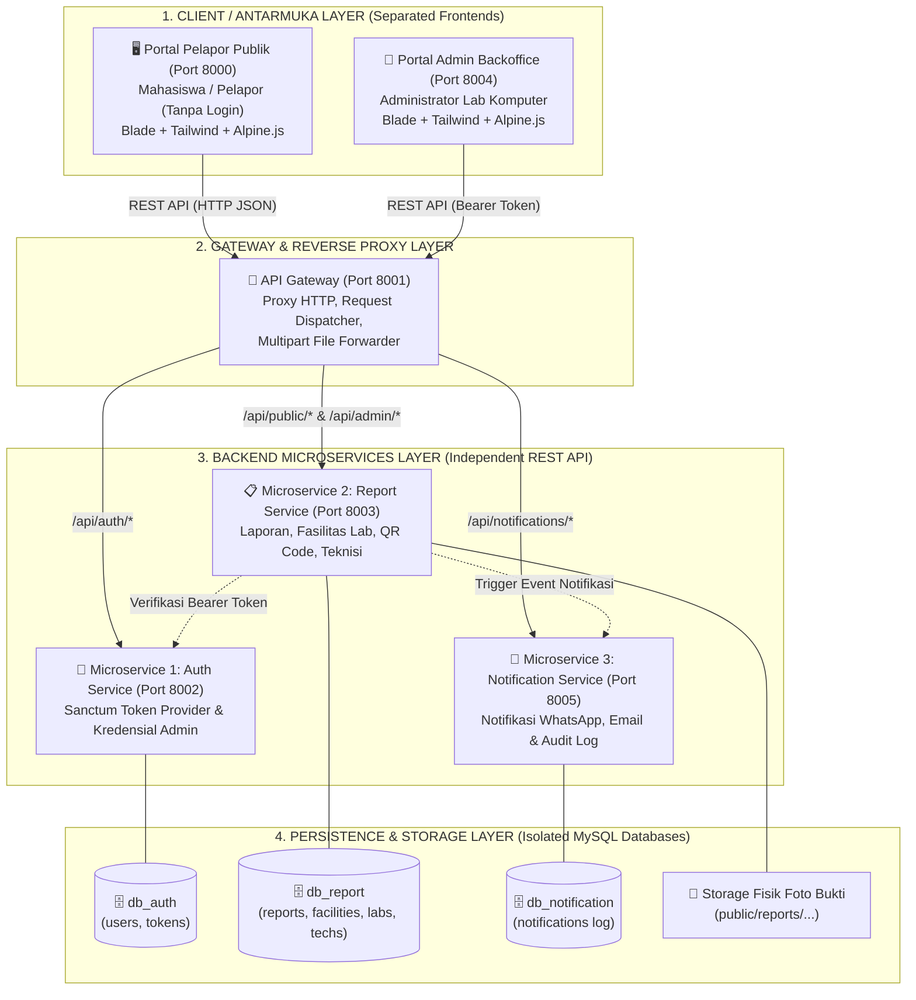
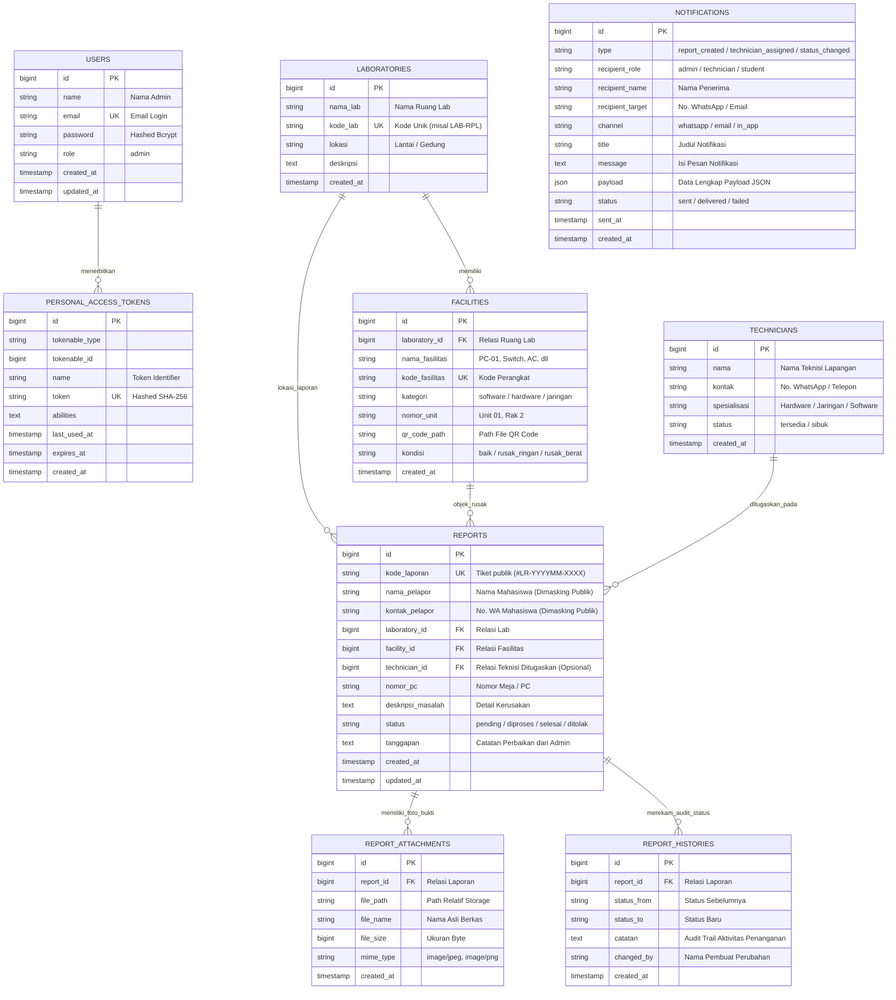
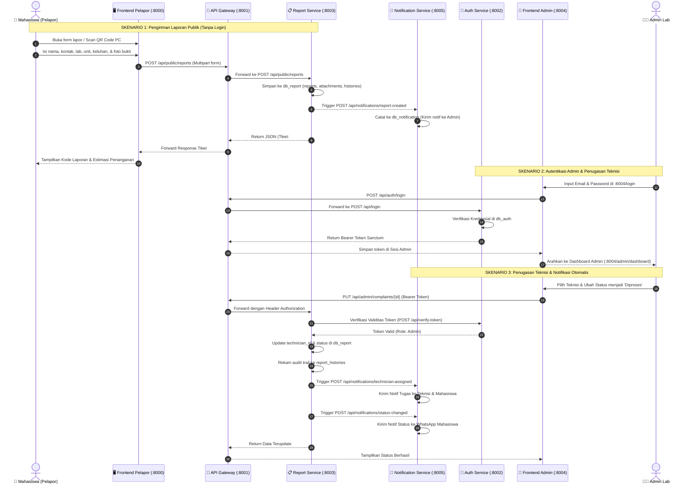

# 🖥️ Sistem Informasi Pelaporan Fasilitas Laboratorium Komputer (LabReport)
### Arsitektur Microservices Mandiri Berbasis Laravel 11 & Multi-Database Terisolasi

[](https://laravel.com)
[](https://php.net)
[-4479A1?style=for-the-badge&logo=mysql&logoColor=white)](https://mysql.com)
[](https://microservices.io)
[](https://tailwindcss.com)

---

## 👥 Tim Pengembang (Authors)

Proyek ini dikembangkan dan disusun sebagai pemenuhan tugas Rekayasa Perangkat Lunak / Arsitektur Aplikasi Komputer:

| No | Nama Mahasiswa | NIM | Peran & Tanggung Jawab |
| :---: | :--- | :---: | :--- |
| **1** | **Ahmad Farel Febrian Pratama** | **`2421400062`** | Perancangan Arsitektur Microservices, API Gateway, Service Integration, & Database Engineering |
| **2** | **Dimas Tajul Fikri** | **`2421400064`** | Perancangan UI/UX Frontend Terpadu, Desain Interaktif Pelapor & Admin, Serta Pengujian Sistem |

- **Dosen Pengampu / Pembimbing:** Ahmad Halimi, S.Kom., M.Kom.
- **Institusi Kampus:** Program Studi Informatika / Teknik — Universitas Nurul Jadid (UNUJA)

---

## 📑 Daftar Isi

1. [Latar Belakang & Konsep Arsitektur](#-latar-belakang--konsep-arsitektur)
2. [Diagram Arsitektur Microservices](#-diagram-arsitektur-microservices)
3. [Entity Relationship Diagram (ERD Multi-Database)](#-entity-relationship-diagram-erd-multi-database)
4. [Katalog 6 Layanan & Port Eksekusi](#-katalog-6-layanan--port-eksekusi)
5. [Alur & Cara Kerja Sistem (Workflows)](#-alur--cara-kerja-sistem-workflows)
6. [Struktur Direktori Project](#-struktur-direktori-project)
7. [Daftar Endpoint REST API](#-daftar-endpoint-rest-api)
8. [Panduan Instalasi & Eksekusi](#-panduan-instalasi--eksekusi)
9. [Hasil Audit & Pengujian Koneksi](#-hasil-audit--pengujian-koneksi)

---

## 💡 Latar Belakang & Konsep Arsitektur

Sebelumnya, sistem pelaporan fasilitas laboratorium komputer berjalan sebagai aplikasi monolitik (*monolith*), di mana kode antarmuka pelapor, dashboard admin, manajemen teknisi, autentikasi, serta seluruh tabel basis data disatukan dalam satu backend. Hal ini menimbulkan kelemahan:
1. **Risiko Keamanan:** Formulir publik dapat menjadi celah akses ke modul administratif admin.
2. **Ketergantungan Ketat (*Tight Coupling*):** Gangguan pada modul pelaporan menyebabkan halaman backoffice admin ikut terhenti.
3. **Penyatuan Basis Data (*Single Point of Failure*):** Data kredensial admin berada di ruang lingkup database yang sama dengan unggahan publik mahasiswa.

### Solusi: Dekomposisi Menjadi Microservices
Sistem ini didekomposisi menjadi **6 Layanan Terpisah (Decoupled)** dengan isolasi penuh:
- **Separated Frontends (Micro-Frontends):** Antarmuka publik mahasiswa (Port 8000) dan antarmuka privat admin (Port 8004) dipisahkan secara fisik.
- **API Gateway (Port 8001):** Titik kontak tunggal untuk routing lalu lintas HTTP, reverse proxy, serta penanganan berkas unggahan bukti kerusakan.
- **Database Terisolasi (*Database per Service*):** Menggunakan 3 database MySQL independen (`db_auth`, `db_report`, `db_notification`) tanpa *foreign key* lintas database.

---

## 🏗️ Diagram Arsitektur Microservices



---

## 📊 Entity Relationship Diagram (ERD Multi-Database)

Sesuai kaidah Microservices Architecture, **setiap microservice memiliki databasenya sendiri**. Relasi antarservice dikomunikasikan melalui ID referensi logis via REST API:



---

## 🚀 Katalog 6 Layanan & Port Eksekusi

| Layanan / Aplikasi | Direktori | Port Server | Database | Peran & Hak Akses |
| :--- | :--- | :---: | :---: | :--- |
| **Portal Pelapor (Publik)** | `pelaporan-lab/frontend-pelapor` | **`8000`** | *Tanpa DB* | **Role: Mahasiswa / Pelapor (Tanpa Login).** Mengakses formulir pengaduan, scan QR code fasilitas, serta pelacakan status tiket. |
| **API Gateway** | `pelaporan-lab/api-gateway` | **`8001`** | *Tanpa DB* | **Pintu Gerbang Tunggal.** Reverse proxy, pengalihan endpoint, verifikasi header, serta penerusan berkas unggahan gambar (*multipart/form-data*). |
| **Auth Service** | `pelaporan-lab/auth-service` | **`8002`** | `db_auth` | **Role: Autentikasi.** Mengelola data pengguna admin, verifikasi kata sandi (Bcrypt), dan mencetak token Bearer Sanctum. |
| **Report Service** | `pelaporan-lab/report-service` | **`8003`** | `db_report` | **Role: Core Business Logic.** Pengelolaan data ruang lab, fasilitas, penugasan teknisi, pencatatan tiket, dan penyimpanan berkas bukti fisik. |
| **Portal Admin (Backoffice)** | `pelaporan-lab/frontend-admin` | **`8004`** | *Tanpa DB* | **Role: Administrator Lab (Wajib Login).** Monitoring dashboard metrik kategori, penugasan teknisi lapangan, update status, dan QR Code generator. |
| **Notification Service** | `pelaporan-lab/notification-service` | **`8005`** | `db_notification` | **Role: Automated Dispatcher.** Mengirim pemberitahuan otomatis ke WhatsApp/Email Mahasiswa, Teknisi, dan Admin serta mencatat riwayat log kirim. |

---

## 🔄 Alur & Cara Kerja Sistem (Workflows)



### Penjelasan Rinci Tiap Alur:

1. **Alur Pelapor (Tanpa Login & QR Code Auto-fill):**
   - Mahasiswa membuka browser di port `8000` atau memindai stiker QR Code yang terpasang pada monitor/unit PC laboratorium.
   - Jika melalui scan QR Code, parameter `?lab_id=X&facility_id=Y` akan otomatis memilih nama ruangan dan nomor perangkat tanpa perlu dicari manual.
   - Mahasiswa mengunggah foto bukti kerusakan (maksimal 5MB) dan menekan tombol kirim.
   - Sistem menerbitkan nomor tiket unik (contoh: `#LR-202611-4508`).

2. **Alur Penjaminan Privasi Pelapor (*Privacy Data Masking*):**
   - Sesuai instruksi penguji untuk menjaga kerahasiaan pelapor, data mahasiswa yang membuka halaman pelacakan publik (`/lacak`) disamarkan:
     - Nama: `Ahmad Farel` $\rightarrow$ `Ah*** Fa***`
     - Nomor Telepon: `081234567890` $\rightarrow$ `0812****890`
   - Data asli hanya dapat diakses oleh Administrator resmi melalui dashboard port `8004`.

3. **Alur Notifikasi Otomatis (*Notification Dispatcher*):**
   - Saat laporan masuk, `Report Service` memicu HTTP call ke `Notification Service` di port `8005`.
   - `Notification Service` merekam pesan ke tabel `notifications` dan mensimulasikan dispatch melalui channel WhatsApp/Email.
   - Admin dapat melihat seluruh rekam jejak notifikasi langsung dari widget dashboard admin.

---

## 📁 Struktur Direktori Project

```text
Backend Micro/
├── pelaporan-lab/                     # SUITE APLIKASI MICROSERVICES
│   ├── frontend-pelapor/              # Port 8000: Portal Publik (Mahasiswa)
│   │   ├── app/Http/Controllers/      # PelaporController.php
│   │   ├── resources/views/pelapor/   # Blade View (create.blade.php, track.blade.php)
│   │   └── .env                       # APP_PORT=8000, DB_CONNECTION=null
│   │
│   ├── frontend-admin/                # Port 8004: Portal Backoffice (Admin)
│   │   ├── app/Http/Controllers/      # AdminAuthController, AdminDashboardController, dll
│   │   ├── resources/views/admin/     # Dashboard terintegrasi kategori & log notifikasi
│   │   └── .env                       # APP_PORT=8004, DB_CONNECTION=null
│   │
│   ├── api-gateway/                   # Port 8001: Router & Proxy Tunggal
│   │   ├── app/Http/Controllers/      # GatewayController.php (Proxy Engine & Multipart)
│   │   ├── routes/api.php             # Route mapping /auth, /public, /admin, /notifications
│   │   └── .env                       # APP_PORT=8001, Forwarding URLs
│   │
│   ├── auth-service/                  # Port 8002: Layanan Autentikasi
│   │   ├── app/Http/Controllers/      # AuthController.php (Login, Verify, Logout)
│   │   ├── database/migrations/       # users & personal_access_tokens
│   │   └── .env                       # DB_DATABASE=db_auth
│   │
│   ├── report-service/                # Port 8003: Bisnis Laporan & Fasilitas
│   │   ├── app/Http/Controllers/      # PublicReportController, AdminReportController, dll
│   │   ├── app/Http/Middleware/       # VerifyAdminToken.php (Proteksi Token Antarservice)
│   │   ├── database/migrations/       # reports, facilities, labs, techs, attachments, histories
│   │   └── .env                       # DB_DATABASE=db_report, Storage Public
│   │
│   ├── notification-service/          # Port 8005: Layanan Notifikasi Terpadu
│   │   ├── app/Http/Controllers/      # NotificationController.php
│   │   ├── app/Models/                # NotificationLog.php
│   │   ├── database/migrations/       # notifications table
│   │   └── .env                       # DB_DATABASE=db_notification
│   │
│   ├── docs/                          # Koleksi Postman API & Dokumentasi
│   ├── tests/                         # Pengujian Otomatis (test_microservices_connection.php)
│   ├── start-microservices.bat        # Skrip Peluncur 6 Terminal Layanan
│   └── stop-microservices.bat         # Skrip Penghenti Seluruh Proses Layanan
│
├── arsip-monolith/                    # Cadangan Berkas Monolith Lama (Diisolasi)
├── start-microservices.bat            # Shortcut Peluncur Layanan dari Folder Root
├── stop-microservices.bat             # Shortcut Penghenti Layanan dari Folder Root
└── README.md                          # Berkas Dokumentasi Teknis Ini
```

---

## 📡 Daftar Endpoint REST API

Seluruh request dari luar ditujukan ke **API Gateway (Port 8001)** dengan format JSON:

### 1. Autentikasi (Auth Service via Gateway)
- `POST /api/auth/login` — Login admin dan memperoleh token Bearer Sanctum.
- `POST /api/auth/verify-token` — Verifikasi keabsahan token (digunakan antarservice).
- `GET  /api/auth/me` — Memperoleh data profil admin yang sedang login.
- `POST /api/auth/logout` — Mencabut (*revoke*) token aktif.

### 2. Pelaporan Publik (Report Service via Gateway)
- `GET  /api/public/form-data` — Memperoleh daftar master ruangan lab dan fasilitas aktif.
- `POST /api/public/reports` — Mengirim formulir laporan kerusakan dan mengunggah foto bukti.
- `GET  /api/public/reports/{kode}` — Melacak status laporan dengan sensor nama & kontak pelapor.
- `GET  /api/public/recent-results` — Melihat daftar pengaduan terakhir yang telah selesai ditangani.

### 3. Modul Admin (Report Service via Gateway - Wajib Bearer Token)
- `GET  /api/admin/dashboard` — Mengambil data statistik kategori (Software/Hardware/Jaringan) & status.
- `GET  /api/admin/complaints` — Menampilkan seluruh daftar pengaduan dengan filter status.
- `GET  /api/admin/complaints/{id}` — Detail laporan, berkas foto bukti asli, dan rekam jejak histori.
- `PUT  /api/admin/complaints/{id}` — Memperbarui status (*pending/diproses/selesai*) dan menetapkan teknisi.
- `GET/POST/PUT/DELETE /api/admin/labs` — CRUD Master Ruang Laboratorium.
- `GET/POST/PUT/DELETE /api/admin/facilities` — CRUD Fasilitas Lab & Generate QR Code otomatis.
- `GET/POST/PUT/DELETE /api/admin/technicians` — CRUD Data Teknisi Lapangan (Pekerja tanpa akun login).

### 4. Notifikasi (Notification Service via Gateway)
- `GET  /api/notifications/logs` — Riwayat log pengiriman notifikasi ke admin, teknisi, dan mahasiswa.
- `POST /api/notifications/report-created` — Dispatch notifikasi laporan baru ke admin.
- `POST /api/notifications/technician-assigned` — Dispatch notifikasi penugasan perbaikan ke teknisi.
- `POST /api/notifications/status-changed` — Dispatch pemberitahuan status terbaru ke WhatsApp mahasiswa.

---

## ⚙️ Panduan Instalasi & Eksekusi

### 1. Prasyarat Sistem
- **PHP:** Versi `>= 8.2` dengan ekstensi `pdo_mysql`, `curl`, `mbstring`, `fileinfo`.
- **Database Server:** MySQL / MariaDB (Direkomendasikan menggunakan Laragon).
- **Composer:** Versi 2.x terpasang secara global.

### 2. Konfigurasi Basis Data
Buka MySQL (phpMyAdmin atau HeidiSQL) dan pastikan 3 database berikut telah dibuat:
```sql
CREATE DATABASE IF NOT EXISTS db_auth;
CREATE DATABASE IF NOT EXISTS db_report;
CREATE DATABASE IF NOT EXISTS db_notification;
```

### 3. Menjalankan Seluruh Microservices (Satu Langkah)
Cukup **klik dua kali (*double-click*)** file peluncur:
```cmd
start-microservices.bat
```
Skrip batch akan otomatis membuka 6 jendela terminal terpisah dan menjalankan server Laravel:
1. `Auth Service` berjalan di `http://127.0.0.1:8002`
2. `Report Service` berjalan di `http://127.0.0.1:8003`
3. `Notification Service` berjalan di `http://127.0.0.1:8005`
4. `API Gateway` berjalan di `http://127.0.0.1:8001`
5. `Frontend Pelapor` berjalan di `http://127.0.0.1:8000`
6. `Frontend Admin` berjalan di `http://127.0.0.1:8004`

### 4. Mengakses Sistem di Browser
- **Portal Pelapor (Mahasiswa):** [http://127.0.0.1:8000/lapor](http://127.0.0.1:8000/lapor)
- **Pelacakan Tiket Pengaduan:** [http://127.0.0.1:8000/lacak](http://127.0.0.1:8000/lacak)
- **Portal Backoffice Admin:** [http://127.0.0.1:8004/login](http://127.0.0.1:8004/login)
  - **Email:** `admin@labreport.com`
  - **Password:** `password`

### 5. Menghentikan Seluruh Layanan
Cukup **klik dua kali** file:
```cmd
stop-microservices.bat
```
Seluruh proses server di port 8000, 8001, 8002, 8003, 8004, dan 8005 akan dimatikan secara bersih.

---

## 🧪 Hasil Audit & Pengujian Koneksi

Sistem dilengkapi skrip verifikasi otomatis untuk memastikan seluruh dependensi, koneksi database, dan integrasi antarservice berjalan sempurna.

Jalankan perintah berikut pada terminal:
```bash
php pelaporan-lab/tests/test_microservices_connection.php
```

### Rekapitulasi Hasil Uji Audit:
```text
====================================================================
   PEMERIKSAAN KONEKSI & INTEGRASI ARSITEKTUR MICROSERVICES
====================================================================

[1/8] Memeriksa Konfigurasi Portal Pelapor (Port 8000)...
      -> Portal Pelapor terisolasi dari database (DB_CONNECTION=null) [PASS]
      -> Portal Pelapor terhubung ke API Gateway (Port 8001) [PASS]

[2/8] Memeriksa Konfigurasi Portal Admin (Port 8004)...
      -> Portal Admin berjalan di Port 8004 (Terpisah dari Pelapor) [PASS]
      -> Portal Admin terhubung ke API Gateway (Port 8001) [PASS]

[3/8] Memeriksa Konfigurasi API Gateway (Port 8001)...
      -> Gateway terhubung ke Auth Service (Port 8002) [PASS]
      -> Gateway terhubung ke Report Service (Port 8003) [PASS]
      -> Gateway terhubung ke Notification Service (Port 8005) [PASS]

[4/8] Memeriksa Auth Service & Database db_auth...
      -> Database db_auth aktif. Admin terdaftar: Administrator Lab (admin@labreport.com) [PASS]

[5/8] Memeriksa Report Service & Database db_report...
      -> Database db_report aktif [PASS]
      -> Data Laboratorium : 3 ruangan
      -> Data Fasilitas    : 7 perangkat
      -> Data Teknisi      : 2 orang (pekerja lapangan, tanpa akun)
      -> Data Laporan Masuk: 5 tiket

[6/8] Memeriksa Notification Service & Database db_notification...
      -> Database db_notification aktif [PASS]
      -> Log Notifikasi Tersimpan: 1 aktivitas notifikasi [PASS]

[7/8] Memeriksa Integrasi Autentikasi Antarservice (Token Verification)...
      -> Token diterbitkan oleh Auth Service: 10|z1FG5DBz9iMC...
      -> Verifikasi Token Antarservice: BERHASIL (Valid = true) [PASS]

[8/8] Memeriksa Pemisahan Portal & Privasi Pelapor...
      -> Portal Pelapor (8000) 100% bebas dari route admin [PASS]
      -> Portal Admin (8004) 100% bebas dari route pelapor [PASS]

====================================================================
   HASIL AUDIT MICROSERVICES: 8/8 LULUS (100% TERHUBUNG)
====================================================================
```

---

## 📜 Hak Cipta & Lisensi
Dikembangkan oleh **Ahmad Farel Febrian Pratama** & **Dimas Tajul Fikri** &copy; 2026. Lisensi didistribusikan di bawah [MIT License](https://opensource.org/licenses/MIT).
